# UI walkthrough audit, 2026-11-21

Read-only audit of every user-facing flow after the owner's first TestFlight session. No product code was changed.
Screenshots are under [`2026-11-21-ui-walkthrough/`](2026-11-21-ui-walkthrough/).

## Scope and method

- Build: verify build (`EXPO_PUBLIC_UI_VERIFY=1`, Release) from `origin/main` at `10f8544c`, on the runner's
  `Tapiro Verify` Simulators (iPhone 17 Pro), taken only through `scripts/sim-lock.sh`.
- Walk: 101 UI cases (100 completed; see the last bullet) chosen to cover every screen and its worst, empty, failed, stale and offline states, run in
  zh-Hans light; `a11y_screens` (25 screens) in zh-Hans, en and ms; a dark pass, an ms pass and a largest Dynamic Type
  (AX5) pass on a subset (see [Checks run](#checks-run)). Every screenshot was opened and read.
- Code read: two read-only passes over `src/app` and `src/features` for state handling (loading/failed/stale shown as
  empty), navigation (context loss, dead ends), accessibility labels, copy and terminology in all three locales.
  Findings from code alone are marked **(code)**; everything else was seen on screen.
- Not re-reported (other agents are fixing them): posted bounty invisible to its poster; board not refreshing;
  choosing an applicant bounces to home; payee page says 「还没有收款方式」 after enabling cash; adding a payee from the
  apply sheet jumps to 我的. Other places with the same pattern are listed as "same pattern as known bug".

Severity: **Critical** blocks a core flow or misleads about money or state; **Important** is clearly wrong or
confusing; **Minor** is polish.

Owner tags: `flow` (fix lives in a feature or route), `shared-ui` (fix lives in a shared `src/ui` primitive or a home
card part that the polish session `tapiro-4b` is editing; coordinate), `motion/perf` (polish session's area).

Coordination: `tapiro-4b` (branch `feat/polish-motion-perf`) is editing `borderCurve` style lines in `StackToggle`,
`BountyCard`, `cardParts`, `CalmCard`, `UnavailableCard`, `ProfileLink`, `Composer`, `DistanceAxis` and
`AskTapirSheet`. Fix batches that touch those files should rebase after its PR merges.

## Counts

| Severity  | Count |
| --------- | ----- |
| Critical  | 0     |
| Important | 20    |
| Minor     | 38    |

Minor includes the seven consistency items reported by the polish session.

No Critical: every money and state screen showed failures and stale data as such (`Loadable`, stale notices, the chat
outbox), and no flow was blocked outright in the fixtures. The Important findings cluster in three places: navigation
that leaves the current tab or sheet, top scroll edges that do not render on SwiftUI-form screens, and copy that
names the same thing differently (worst in ms).

## Top 20

The 20 Important findings, ordered by how often a user meets them and what they cost.

| #   | ID  | Sev       | Owner     | Finding                                                                                                              |
| --- | --- | --------- | --------- | -------------------------------------------------------------------------------------------------------------------- |
| 1   | N1  | Important | flow      | Bounty/ride card in a chat pushes into another tab; back does not return to the chat (and the reverse)               |
| 2   | P3  | Important | flow      | 「先去付款」 on the post confirm closes the post sheet; the user must reopen + and walk the form again               |
| 3   | R1  | Important | flow      | Ride confirm 「去加收款方式」 closes the sheet and jumps to 我的 → 收款方式 (same pattern as known bug)              |
| 4   | D1  | Important | flow      | Poster opening their own open or expired bounty sees no status line and no action (no 「查看申请人」)                |
| 5   | O1  | Important | flow      | Onboarding name step can overwrite an existing profile name/avatar while the profile is loading or failed            |
| 6   | S1  | Important | flow      | Top scroll edge missing on 进度 (status) and profile: content slides under the back button and status bar            |
| 7   | S2  | Important | flow      | 问小貘 sheet: conversation scrolls under the grabber and the close button                                            |
| 8   | Y1  | Important | flow      | Pay sheet 「对方还没有收款方式」 is a dead end: no message/remind action; en/ms name a menu path that does not exist |
| 9   | A1  | Important | flow      | 删除账号 blocked by unsettled payments lists them, but the rows cannot be tapped to settle them                      |
| 10  | H1  | Important | flow      | Calm card says 「说一句话，小貘帮你发悬赏」: the AI only drafts; the user publishes                                  |
| 11  | H3  | Important | flow      | Accessory strip shows an unrelated payment on pages that have their own pay or confirm bar (two money prompts)       |
| 12  | O2  | Important | flow      | Language step title clipped at the left edge in en (「orefer?」)                                                     |
| 13  | L1  | Important | flow      | Time chips truncate: ms 「Sebelum tengah h…」 (post form), en 「Pick a ti…」 (ride form)                             |
| 14  | H2  | Important | flow      | ms home: 「Ganjaran yang Boleh Anda Ambil」 wraps into the tilted list/map switch                                    |
| 15  | C1  | Important | flow      | Two names for the sticker book: 「看看贴纸本」/「收进贴纸本」 open a page titled 「一起办成的事」                    |
| 16  | C2  | Important | flow      | ms money terms collide: Selesai means both "done" and "settled"; Ganjaran means both "bounty" and "reward"           |
| 17  | C3  | Important | flow      | ms has six spellings of 收款方式, one of which (Cara Bayaran) reads as "way to pay"                                  |
| 18  | O3  | Important | flow      | Terms and Privacy show 「草稿：上架 App Store 前会替换为正式文本。」 in release builds; contact is a personal Gmail  |
| 19  | Y2  | Important | flow      | Payee list keeps old data after a failed refresh with no stale marker, and never refetches on focus (code)           |
| 20  | H4  | Important | shared-ui | Disabled pill buttons are white on light grey and unreadable (Tapir jar 「Swap 1 coin for a leaf」, post 「发出去」) |

## Findings by flow

### Onboarding, sign-in, profile setup, language

**O1 · Important · flow · (code)** Onboarding name step can overwrite a returning user's profile.
`src/app/onboarding/index.tsx:33` passes `profile` as `null` while the profile is loading or failed;
`NameStep.tsx:48` then pre-fills the Apple/Google name and the button stays enabled. `onboardedStorage` is per device,
so a reinstall or a new phone goes through this step again, and 继续 writes the provider name and avatar over the
user's chosen one. A failed load is never retried. Why: silent data loss on the first screen after reinstall.
Fix: pass the load status into `NameStep`; spinner while loading, error with retry on failure, save only once the
profile is known.

**O2 · Important · flow** Language step title clipped in en.
The second line of 「Which language do you prefer?」 renders as 「orefer?」: the left side of the `p` is cut off. zh-Hans
fits on one line; ms 「anda?」 starts with a glyph without left overhang. Likely cause: the `InkText` sits in an
`RNHostView` inside a SwiftUI `Form` row with zero insets, which clips glyph overhang at x = 0
(`src/features/account/LanguageStep.tsx:36`). Fix: give the hosted heading a few points of horizontal padding (or
stop the host clipping), and check the name step with the same structure.
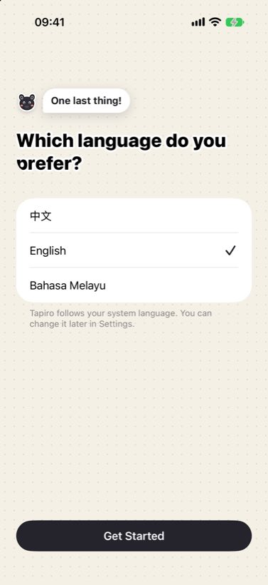

**O3 · Important · flow** Legal pages ship a draft disclaimer and a personal address.
Terms and Privacy start with 「草稿：上架 App Store 前会替换为正式文本。」 (`account.legal.draft`), rendered without a
gate, and the contact line is a personal Gmail (`account.legal.contact`). Neither is listed as a pre-release item in
`docs/status.md`. Why: App Review reads these pages. Fix: replace the text and drop the line before submission; list
it in status.md now; use a product-domain address.

**O4 · Minor · flow** The name step's top-left button is 「退出登录」, not back. A user who signed in with the wrong
Apple ID can recover, but a user who just wants to go back loses the session. Consider a confirmation.

### Home (悬赏令) and live cards

**H1 · Important · flow** Calm card copy says the AI posts.
`home.card.calm.ask` 「说一句话，小貘帮你发悬赏」 / 「Say it and Tapir posts the bounty」. The AI only drafts; AGENTS.md
says nothing is published without the user's tap. Fix: 「说一句话，小貘帮你写悬赏」 / 「…drafts the bounty」, ms to match.
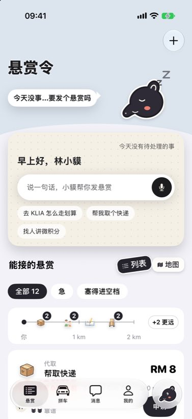

**H2 · Important · flow** ms home header collides.
「Ganjaran yang Boleh Anda Ambil」 wraps to two lines and runs into the tilted 「Senarai」 sticker of the list/map
switch. Fix: let the title take the full
row and move the switch below it when the title wraps (or shorten the ms title to 「Boleh Diambil」).
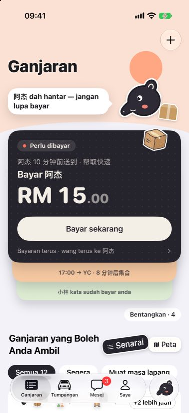

**H3 · Important · flow** Two money prompts at once.
The accessory strip always shows the most urgent item, even on pages that have their own pay or confirm bar. On a
bounty's 进度 page with 「去付款」, the strip above the tab bar says 「付给阿杰 RM 15.00」 for a different payment
(money_worst/04). On the status page the action bar, the strip and the tab bar stack to about a fifth of the screen.
Why: two amounts to two people on one screen invites paying the wrong one. Fix: hide the strip on pushed item pages
(or when the page's own primary action is a payment); keep it on tab roots.
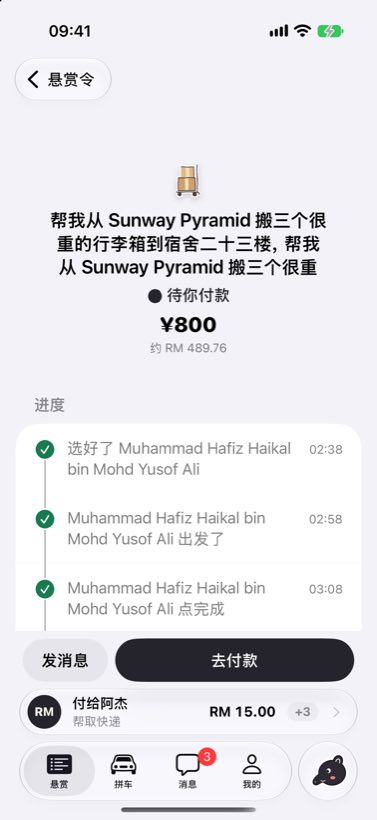
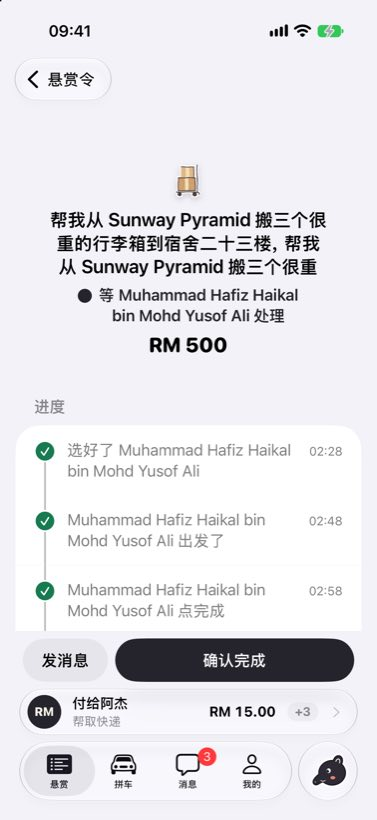

**H4 · Important · shared-ui** Disabled pill buttons are unreadable.
White label on a light grey fill: 「Swap 1 coin for a leaf」 in the Tapir jar, 「用 1 颗貘币换一片」 in zh, and the
disabled 「先选一个人」/「发出去」 in other flows. HIG: a disabled control stays legible. Fix in `PillButton`'s disabled
style: tertiary label colour on the fill, not white.
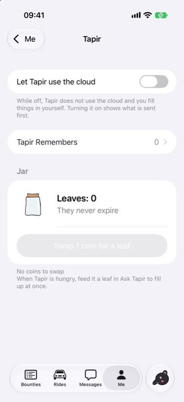

**H5 · Minor · shared-ui** Card buttons differ in size: 「去付款」 on the pay card is visibly taller than 「收进贴纸本」 on
the settled card stacked under it (see Consistency 1).
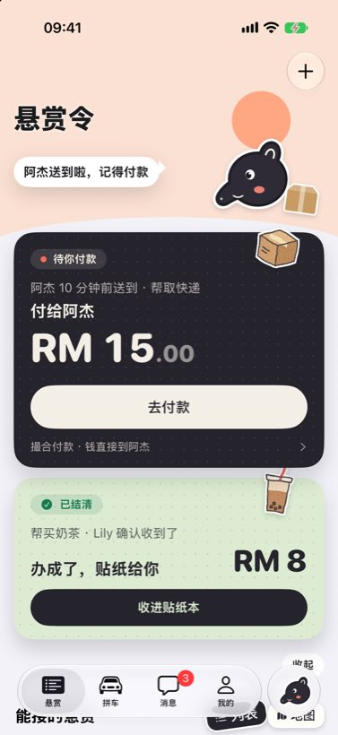

**H6 · Minor · flow** Every board row has a black ink 「申请」 pill, so a scrolled board shows six or more ink buttons.
The design language reserves the ink accent for the one primary action on screen. Fix: a tinted or bordered secondary
pill in rows; keep ink for the detail page's 申请.
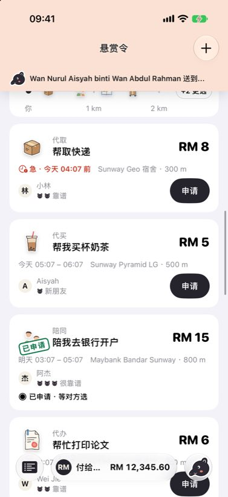

**H7 · Minor · flow** 「撮合付款 · 钱直接到{{name}}」 (`home.card.pay.footer`): 「撮合」 is internal jargon and contradicts
「钱直接到」; en already says 「Direct pay」. Fix: 「直接付款 · 钱直接到{{name}}」.

**H8 · Minor · flow** en card tags: `home.card.ride.tag` reads 「Ride · 4 full」; `home.card.owed.tag` 「Confirm」 looks
like a button but is a label. Fix: 「Ride · all 4 in」, 「Needs your confirmation」.

**H9 · Minor · flow** The calm card's three example chips look tappable and do nothing (a known limit in the
foundation spec). Smallest fix: open 问小貘 with the line pre-filled.

### Board, map, filters

**B1 · Minor · flow** On the full-screen map, a pull to refresh pans the map instead (the gesture lands on MapKit) and
leaves the user on an empty region with no pins and no "back to pins" control (bounty_board_map_states/09).
Fix: no pull-to-refresh over the map; a refresh button in the toolbar, plus a recentre control.

### Post a bounty

**P3 · Important · flow · (code)** 「先去付款」 closes the post sheet.
On 确认发布 with an unpaid payment, 「先去付款」 (`src/app/bounty-post/confirm.tsx:15`) and the 「去付款」 in the
blocked-post alert (`(tabs)/bounty/index.tsx:86`, `ask.tsx:44`) dismiss the post sheet. After paying, the user is on
home and must tap + and step through the form again (the draft is kept, but the context is lost). Same pattern as the
known payee bug. Fix: present `/pay/[id]` over the post sheet and return to confirm.

**L1 · Important · flow** Time chips truncate.
Post form 几点前: ms 「Sebelum tengah h…」 (「明天中午前」); ride form 出发: en 「Pick a ti…」. The chips have a fixed
width in a three-column row. Fix: let the row wrap (or size chips to content and scroll), never truncate a choice.
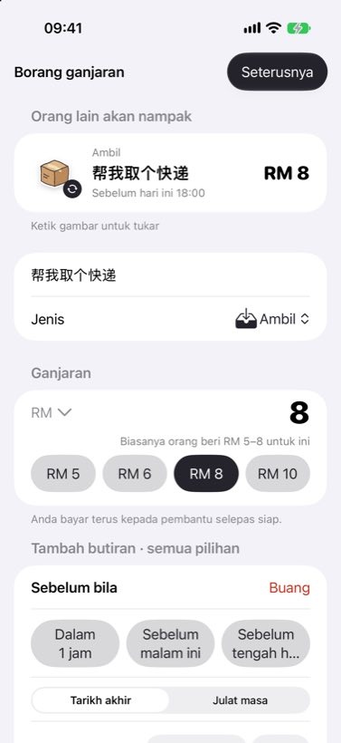
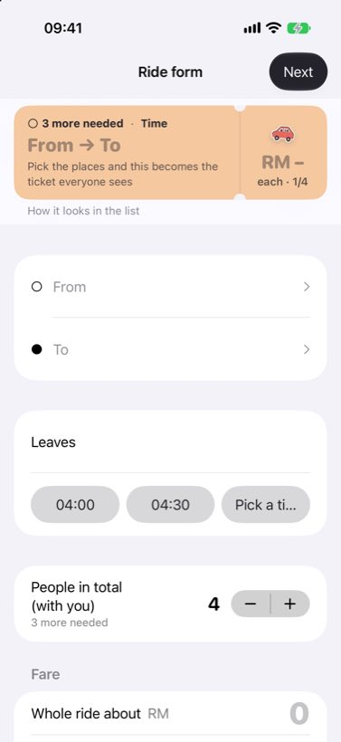

**P4 · Minor · flow** The same fields have different names across the flow: the form's sections are 「几点前」 and
「在哪取」, their add rows 「时间」 and 「地点」, and 确认发布 uses 「时间」 and 「地点」. Pick one pair.

**P5 · Minor · flow** The reward field opens a number pad with no Done key; the only way out is to scroll the form
(`scrollDismissesKeyboard`). Add a keyboard toolbar 「完成」.

**P6 · Minor · flow** In zh the 「明天中午前」 chip wraps to two lines while its neighbours have one, so the row has
uneven heights (bounty-post a11y screen).

### Bounty detail, apply, applicants, progress

**D1 · Important · flow · (code)** Poster's own bounty has no actions.
For the poster, `detailAction` returns `'none'` and `PartyActions(null, null)` renders nothing
(`src/features/bounty/detail/BountyDetailScreen.tsx:190`). The 「悬赏过期了」 notification (sent to the poster too,
migration `20261105000100`) routes to `/bounty/[id]` (`src/lib/notifications/routes.ts:22`), where the poster sees a
live-looking bounty with no explanation and no way to see applicants, close or repost. Related to the known
"invisible to its poster" bug but a separate screen. Fix: for `viewerRole === 'poster'` show the status line and
「查看申请人」; route the poster's `bounty.expired` to applicants.

**D2 · Minor · flow** Apply sheet after 「这悬赏已经有人接了，不能申请」 keeps the text field editable and 发送 disabled,
with no way forward. Fix: replace the field with 「看看别的悬赏」.
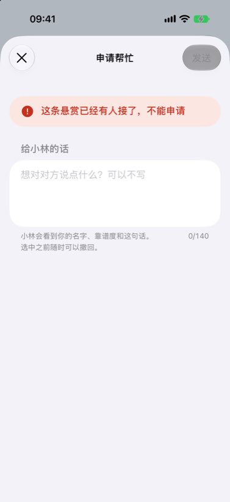

**D3 · Minor · flow** 「已申请 · 等对方选」 on board rows and the 「已申请」 stamp on the sticker say the same thing twice
in one row.

### Status (进度) and scroll edges

**S1 · Important · flow** Top scroll edge missing on 进度 and profile.
Scrolled, the timeline and the header text slide under the back button and the status bar with no edge effect
(status worst, status states, profile worst). Both routes set `scrollEdgeEffects: { top: 'automatic' }`; both
screens scroll inside an `@expo/ui` SwiftUI `Form`, which react-native-screens does not find as the screen's scroll
view. Board, list and chat (RN scroll views) are fine. Fix: make the SwiftUI form report its scroll view, or give
these screens a native `scrollEdgeEffect` from the kit; check every `Form`-based pushed screen.
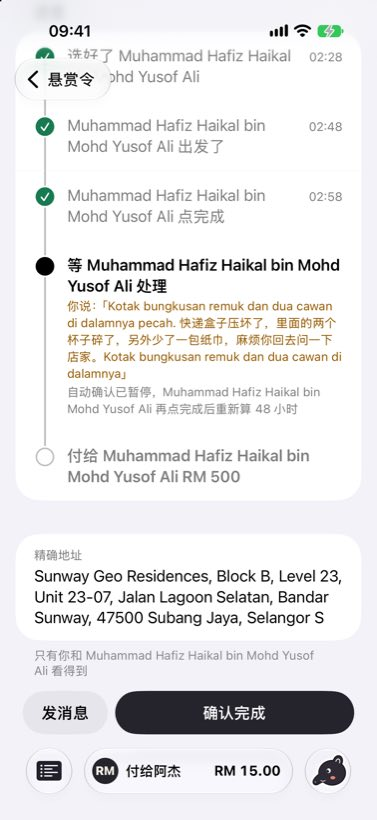
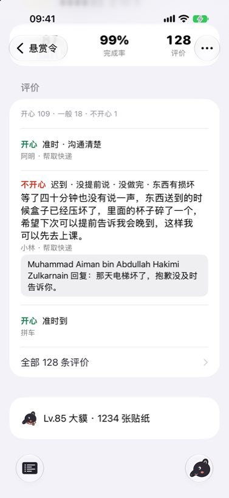

**S3 · Minor · flow** Ride settle's pinned status line 「你说已付 · 等 X 确认」 sits on the scrolled timeline with no
background, so text overlaps text when the timeline is long.
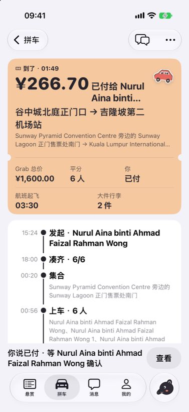

### Pay, payee methods

**Y1 · Important · flow** Pay sheet with no usable method is a dead end.
「阿杰还没有可用的收款方式 · 请对方在「我的 → 收款方式」里添加后再付」: the payer has no action (no 发消息, no remind),
only the close button. en says 「Me → Ways to receive」 and ms 「Cara terima bayaran」, but the rows are called
「Payment Methods」 / 「Kaedah Terima Bayaran」 (`pay.sheet.none.body`). Fix: add 「发消息提醒」 that opens the thread
with a prefilled line; fix the en/ms paths.
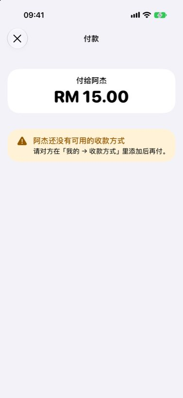

**Y2 · Important · flow · (code)** Payee list shows old data as current.
`src/features/payee/payeeStore.ts:21-27, 50-51`: a failed refresh after a save leaves the old list with no stale
marker (the save said OK, so the new method is just missing), and `ensureLoaded` returns early once ready, so the list
never refetches on focus. May share a cause with the known 「还没有收款方式」 bug. Fix: stale state with retry;
refetch when 收款方式 gains focus.

**Y3 · Minor · flow** Cash has two entry points and three names: the 「当面 · 可以当面收现金」 switch, 「现金当面付」 in
the + menu, and 「现金当面付」 on the pay sheet. Keep one control and one name.
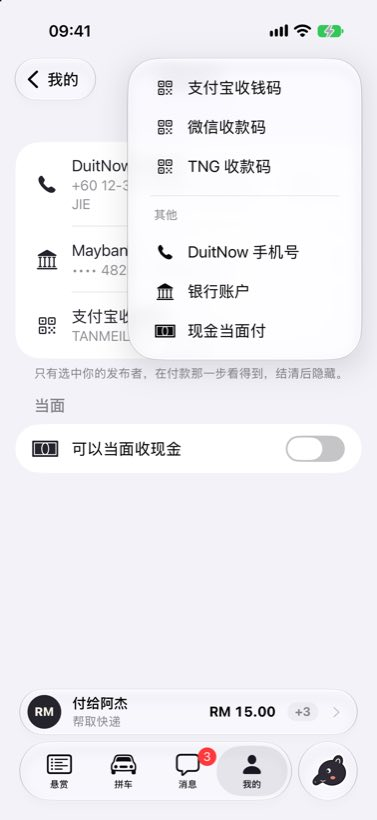

**Y4 · Minor · flow · (code)** A payment that no longer exists shows 「付款信息没加载出来 · 请检查网络后重试」
(`PaySheet.tsx:123`, `status: 'missing'`); retry can never succeed. Show 「这笔付款已不存在」 with close.

**Y5 · Minor · flow** Rate source is named two ways: 「马来西亚国家银行中间价」 on the celebration, 「BNM 中间价」 on the pay
sheet.

### Chat and translate

**N1 · Important · flow · (code)** Item card in a chat switches tabs.
`src/app/(tabs)/messages/[thread].tsx:18`: tapping the bounty or ride card pushes `/bounty/status/[id]` or
`/ride/[id]`, which live in the 悬赏 and 拼车 stacks, so the app jumps tabs and back goes to the board or ride list,
not the conversation. The reverse (发消息 from status or ride) navigates into 消息 the same way. Profile routes are
already duplicated per tab to avoid exactly this. Fix: add `status/[id]` and `ride/[id]` to the messages stack (as
`profileHref(tab, …)` does), or present the item as a sheet over the chat.

**N2 · Minor · flow** A failed image in a thread is a grey box with a small reload glyph and no text. Add 「没加载出来 ·
点一下重试」 and a VoiceOver label.

**N3 · Minor · flow** The safety banner 「钱只在「付款」那一步付…」 is pinned at the top of every thread forever,
about 10% of the screen. Show it until dismissed or for the first messages only.
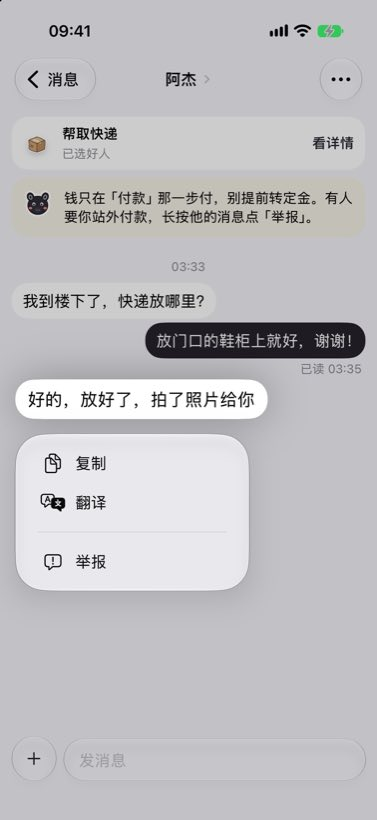

**N4 · Minor · flow** Translation quota hit from chat opens 问小貘 with 「小貘饿了 · 明早再来 / 自己填」; 「自己填」 means
nothing for a translation. Use 「先不翻译」 there.
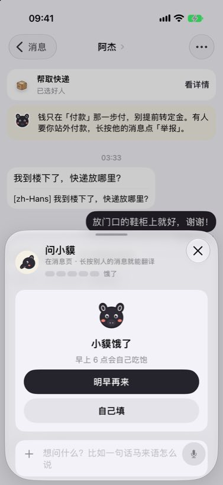

**N5 · Minor · flow · (code)** Notification taps for bounty, ride and pay use `push`
(`src/lib/notifications/noticeTaps.ts:24`), so a tap while on that item's page, or two taps for one item, stack
identical screens. Use `navigate` or skip when the route matches.

### Carpool

**R1 · Important · flow** Ride confirm 「去加收款方式」 closes the sheet and jumps to 我的 → 收款方式; after adding a
method there is no way back to the confirm step (`src/app/ride-create/confirm.tsx:15`). Same pattern as the known
apply-sheet bug; seen on screen.

**R2 · Minor · flow · (code)** 拼车记录 loads once and never refreshes (`RideHistoryScreen.tsx:22`); no pull to refresh
or refetch on focus. Mirror `useRideList`.

**R3 · Minor · flow · (code)** 「看看贴纸本」 after a ride settles, from the pay celebration and from your own profile
switches to the 我的 tab (`(tabs)/ride/[id].tsx:15`, `pay/[id].tsx:16`, `reputation/profile/routes.tsx:65`); back
does not return.

**R4 · Minor · flow** The settle celebration says 「又帮成一单」 / 「This errand's sticker」 for rides too; 「Errand」 is
also the en name of the 代办 category. Split copy by item kind.

**R5 · Minor · flow** 「放鸽子」 in the appeal copy (「这次放鸽子照常算」) is a joke word in a dispute; the voice table
says disputes are plain. Use 「没上车」.

**R6 · Minor · flow · (code)** Three ride VoiceOver labels join parts with a hard-coded Chinese 「，」
(`DetailCards.tsx:65`, `SettleSteps.tsx:116`, `Avatars.tsx:82`), read oddly in en and ms.

### 问小貘

**S2 · Important · flow** Sheet content scrolls under the grabber and close button.
After picking a draft from a screenshot, the conversation scrolls up and 「截图里有 2 件事，要哪个?」 sits under the
grabber with the close button over the first choice. No top edge treatment inside the sheet. Fix: a top scroll edge
(or a fixed header band) in `AskTapirSheet`. Coordinate with `tapiro-4b`, which is editing that file.
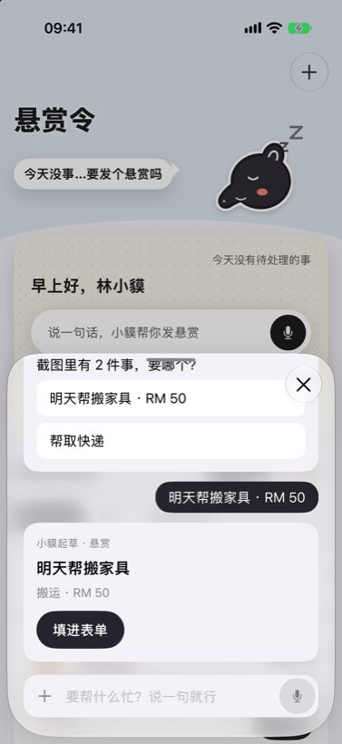

**K1 · Minor · flow** Error copy jokes: 「小貘晕了，没扣体力」 (provider error), 「没喂上，再点一下试试」 (feed failed). The
voice table says errors are plain. Keep the tapir, drop the joke: 「没连上小貘，没扣体力」.
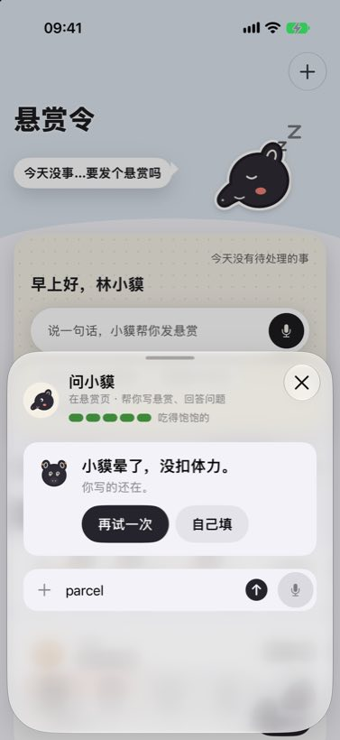

**K2 · Minor · flow** Dark: when the tapir is hungry, the empty belly pips under 问小貘 are grey on grey glass and
disappear; only 「饿了」 is left. Use a visible outline for empty pips. The hungry card's primary pill is 「明早再来」,
which only closes; make 「自己填」 the primary (it moves the task on).

**K3 · Minor · flow** en uses first person once (「I'm keeping an eye on it」, `home.say.live`) where Tapir is third
person everywhere else.

### 我的: settings, coins, invite, account

**A1 · Important · flow** Delete account blocked: rows are not tappable.
「你还有没结清的付款，结清后才能删除账号」 lists six payments, but `DeleteAccountSheet.tsx` only wires 删除/取消; the rows
do nothing. The user has to find each payment elsewhere. Fix: each row opens its pay sheet (or the item's 进度).
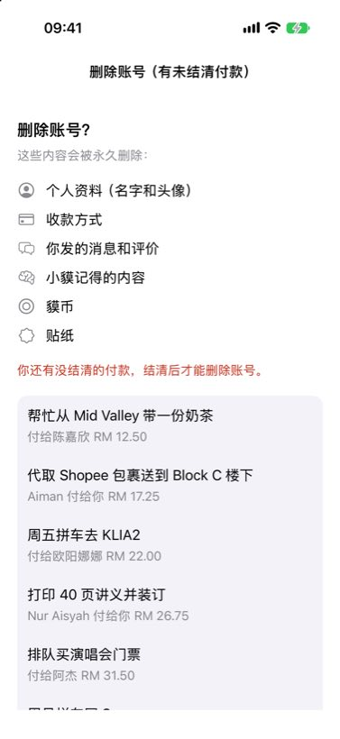

**A2 · Minor · flow** Invite code field's submit button is 「好」. Use 「兑换」.

**A3 · Minor · flow** en: 「Your Tapir coins」 appears once; everywhere else it is 「coins」. ms capitalises 「Syiling」
mid-sentence.

### Copy and terminology

**C1 · Important · flow** The sticker book has two names.
「看看贴纸本」 (celebration, ride settle), 「收进贴纸本」 (settled card) open a page titled 「一起办成的事」, which is also
its row in 我的. A user told to look in 贴纸本 cannot find it. Fix: one name in all three locales (and one en
capitalisation).
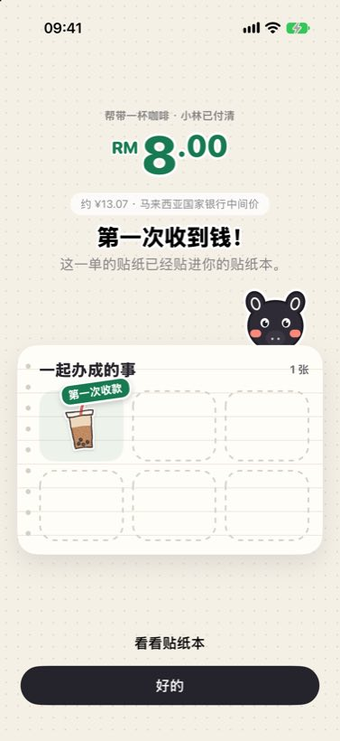

**C2 · Important · flow** ms money terms collide.
「Selesai」 is used for settled (`pay.sheet.settled.title`, `bounty.status.summary.*.settled`,
`rideSettle.ticket.stamp`) and for done (`pay.sheet.qr.done`, `bounty.status.a11y.done`); the settled home card says
「Langsai」 and chat/ride say 「Sudah dijelaskan」. 「Ganjaran」 is both the bounty (tab, 「Pasang Ganjaran」) and the
reward amount on the same form. Fix: settled = Langsai everywhere, Selesai only for done; reward = Bayaran.

**C3 · Important · flow** ms has six spellings of 收款方式 (Kaedah Terima Bayaran, cara terima bayaran, Cara Bayaran,
kaedah pembayaran, kaedah bayaran, Tambah Kaedah); 「Cara Bayaran」 (`bounty.apply.noPayee.add`) reads as "way to pay".
Use 「Kaedah Terima Bayaran」.

**C4 · Minor · flow** en ride 「Requested · waiting」 vs 「Asked」, ms 「Sudah memohon」 vs 「Sudah mohon」; bounties use
「Applied」.

## Consistency (static, from polish session)

Reported by `tapiro-4b` from code; checked against the code here and, where marked, on screen.

1. **Minor · shared-ui** Home live-card buttons differ: `PayCard.tsx:16,86-93` 52 pt, body/600, padding 20;
   SettledCard collect 44, secondary/700, padding 16; `BountyCard.tsx:179-187` 44, secondary/700, no `borderCurve`;
   `UnavailableCard.tsx:46-53` 44, body/600, no padding, label (`:36`) without `numberOfLines`. Seen on screen (H5).
   Suggest one `CardButton` in `home/cards/cardParts.tsx`; check the canvas whether the pay card's 52 pt is intended.
2. **Minor · shared-ui** Pressed/selected row fill differs: `systemFill` (`ThreadRow:113`, `RideListParts:149`,
   `TicketLink:41`) vs `systemGray4` (`BoardCard:100`, `PlaceRow:121`, `ProfileLink:118`); radius chip 12 vs card 18.
3. **Minor · shared-ui** Capsule heights in the card stack: `cardParts:57` 24, `StackToggle:49` 28, `CalmCard:163`
   `minHeight: 30` (raw number).
4. **Minor · flow** Stamp radius: `bounty/shared/appliedStamp.tsx:27` 6 vs `ride/detail/FullTicket.tsx:258` 8.
5. **Minor · flow** Map elevation: `MoreChip:53-55` blur 8 y 2, `PinCard:175-177` blur 12 y 4, pin tail `:190-192`
   blur 6 y 2 (the tail should match its card).
6. **Minor · flow** `ask/MemoryCards.tsx:136` gap 8 vs 12 in `FailureCard:50` / `ApplicationCard:120`. Verified in code.
7. **Minor · flow** `shell/UrgentAccessory.tsx:170` pressed opacity `0.6` instead of `vars['--opacity-pressed']`
   (verified in code); `:173` amount not SF Rounded; `:116-121` +N pill lacks rounded/tabular numerals.

## Checks run

Selection and reasons: an audit of every screen, so each screen's worst/failed/empty case in zh-Hans light; dark,
ms and AX5 on one case per screen family because colour, copy length and text size are cross-cutting.

- zh-Hans light (101 cases): welcome, sign-in, account flow, long names, settings, delete (blocked, many), onboarding,
  language; home (worst, three cards, calm, payments failed, settled, inline, title strip); board (worst, states, map
  worst/states, location); post (worst, failed, no balance, blocked, draft, place, publish, place search); detail,
  outcome, apply (ok, failed, no payee), applicants (worst, progress), select failed, status (worst, states),
  withdraw; pay sheet (none, no method, wallets), mark paid/undo, first settle, payee list/long/QR, money worst,
  storefront China, shell tabs; chat list (worst, empty, failed), thread (worst, failed, menu), translate (worst,
  China), images, block, report; ride list (worst, empty, failed), create (worst, confirm, payee), detail (worst,
  organiser), settle worst, meetup stale, history, appeal; ask consent (sheet, settings), sheet worst, draft fill,
  voice blocked, energy, memory worst; coins page (worst, failed), buy (states, failed), invite (worst, redeem
  errors); profile (worst, failed, new), review sheet (worst, failed), tier drop, sticker book (empty, full), weekly
  feed failed, live detail, mascot accessory failed.
- `a11y_screens` (25 screens) in zh-Hans, en and ms, light.
- zh-Hans dark (16 cases): home three cards, calm, board worst, detail, status states, pay sheet wallets, payee
  list, chat thread worst, ride list and detail worst, ask sheet worst, coins page worst, profile worst, sticker book,
  welcome, account flow. All passed. The light stage and cards on dark are decision D2 in the design language, not a
  finding. S1 reproduces in dark; K2 is the only dark-only issue.
- ms light (8 cases): home worst, post form, ride form, translate, pay sheet wallets, buy coins, status worst, consent
  sheet. All passed; H2, L1 and the C-series terminology are the ms issues seen.
- AX5 (largest accessibility size, 7 cases): text scales everywhere and nothing essential is clipped. Six cases fail
  their layout assertions, which are written for the default Large size (AGENTS.md: acceptance runs at Large, no
  separate accessibility layouts). The visible cost is very tall rows: on the pay sheet each method name wraps two
  characters per line beside its amount. No finding filed, given the project rule.
- Skipped: a live two-account flow on the local stack. Reason: the local stacks running today belong to the agents
  fixing the five known bugs (which are exactly the live-data bugs), and every flow here has fixture cases that reach
  the same screens. `payee_add_bank` did not complete twice (the AXe automation session timed out under a load
  average near 100); not a product failure, and its screens are covered by `payee_list` and `payee_qr`.
